# SO-101 follower: camera metrology results (Phase 2)

*2026-10-26 → 2026-10-31. One Sony A7 IV (35 mm, f/11) at ~0.6–0.7 m; an iPad showing a pixel-exact ChArUco board as
the fixed reference; a 20 mm AprilTag (36h11 ID 2) on the gripper. Every arm measurement is the tag's pose
**relative to the iPad seen in the same photo**, so camera motion cancels.*

## Headline

> **Out of the box, the SO-101 follower puts its gripper ~8 mm from where it's told, mostly sagging low under
> gravity. Calibrated against a camera, it reaches ~2 mm RMS (≤ 3 mm worst case) and repeats to under 1 mm.
> Repeatability is set by the servos' deadband, not by gear backlash. Drift while holding a pose is a tick-sized
> re-settle that the servo's own encoder reports, not thermal creep.**

| | Value | Step |
|---|---|---|
| **Accuracy, nominal model** (commanded) | 8.2 mm 3D RMS; lands ~7.5 mm low | 10b |
| **Accuracy, calibrated + one encoder correction** (commanded) | **1.9 mm 3D RMS**, 1.5 mm lateral, max 3.0 mm | 10b |
| **Knowing where it is** (calibrated model from encoder readings) | 0.8 mm lateral, 1.1 mm 3D RMS | 10 (independent test) |
| **Repeatability** (same target, same approach) | **0.7–0.9 mm** (ISO 9283 RP) | 8 |
| Direction-dependent offset | 5–12 ticks per joint = servo deadband; hidden gear backlash ≲ 1 tick | 8 |
| Drift while holding (45 min, elbow 29 → 41 °C) | one 1-tick step (−0.43 mm), otherwise ≤ 50 µm (~1 µm/min); reversible | 11 |
| Measurement floor (tag relative to iPad, per shot) | 5–15 µm lateral, ~100 µm depth | 5b |

**Conditions:**

- **Where:** measured at the gripper tag, not the tool tip (D13), in the inner workspace (~0.2–0.45 m reach, ≤ ~270 mm high, shoulder-lift gravity torque ≤ ~0.75 N·m). At far-forward reach the errors grow to 2.5–5 mm.

- **Arm state:** warmed up, 3 s settle, quasi-static.

- **Scale:** absolute scale nominal (≤ 0.3 %, D4).

---

## 1. Measurement system

| Item | Result | Step |
|---|---|---|
| Tethered capture (gphoto2) | 50/50, 5.9 s per 67.6 MB RAW | 1 |
| Intrinsics | 41 iPad views, RMS 0.166 px; fx 7007.4, fy 7006.2 px; bottom 21 % of the frame uncalibrated | 4 |
| Rig stability (iPad only, 1 h) | ≤ ~40 µm/h | 5 |
| Tag corner refinement | edge-line fit on linear (gamma 1) RAW; bias ≤ 0.03 px, scatter ~0.02 px (synthetic). OpenCV SUBPIX biased ~0.17 px inward; gamma shrinks the tag 0.2–0.6 px per edge | 5b |
| Floor, hands off the table (`20261030-113927`) | tag rel. iPad per shot: 15.6 / 5.5 / 107 µm (x / y / depth); drift ≤ ~23 µm/h | 5b(a) |
| Blur | soft focus (edge 0.23 px) ≈ 2× corner noise of sharp (0.055 vs 0.028 px); usable for relative work | 6 |
| Hand-eye model (camera ← base, tag ← gripper) | 2.2 mm RMS at the tag; predicted every lost-tag pose from joint angles alone | 6 |

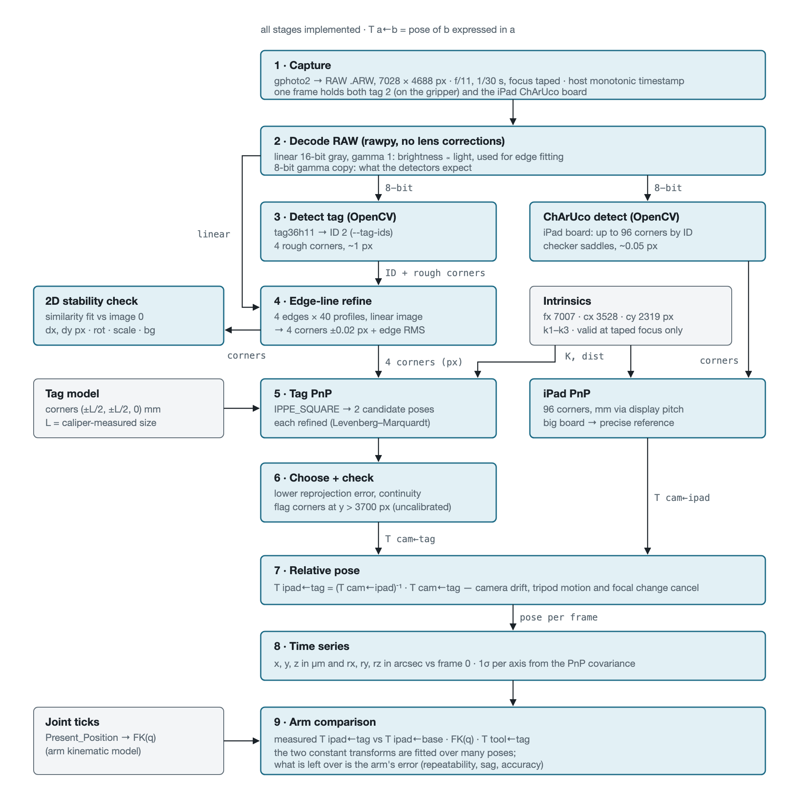

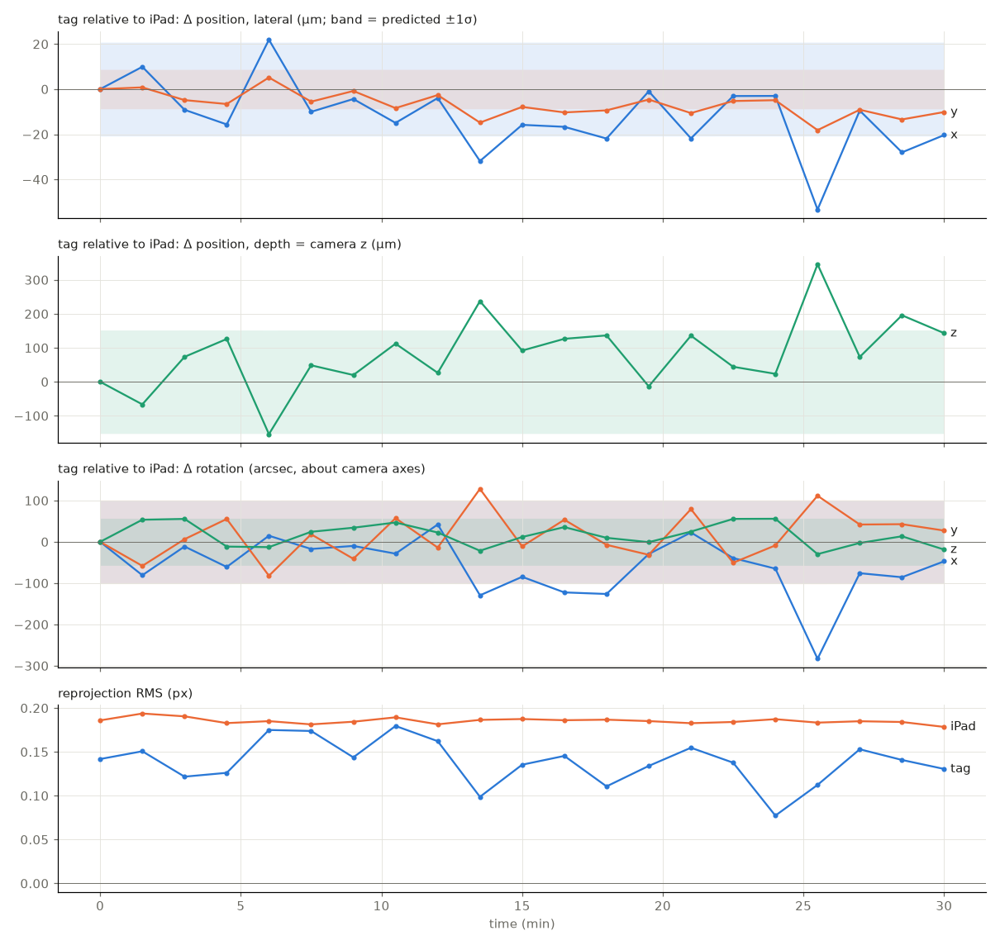

**Lessons:**

- **Touching the table** moved the camera 0.13 mm.

- **Sign bug:** the background-motion tracker's sign was inverted (LESSONS #5).

- **The workspace was set by the camera's depth of field and field of view,** not by the arm.

## 2. Workspace and the dry run (step 6)

- **Workspace definition:** extremes taught by hand (17 poses) → a spherical sector → an even grid, each pose checked for table clearance, the iPad-side pan limit and predicted tag visibility.
- **Dry run:** 29/29 captures, manifest matching the files 1:1, no stillness flags, tag found at 28/29.

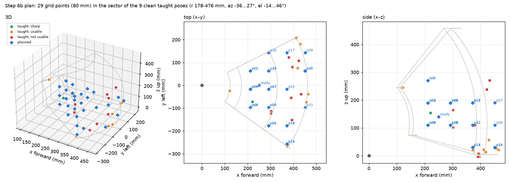

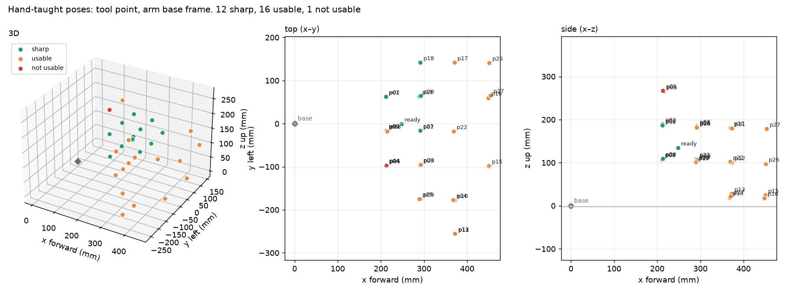

Animation: `../figures/capture_tour.gif`.

## 3. Repeatability and backlash (step 8, `20261030-170704`)

| Target | sd x / y / z (µm) | RP 3D | RP lateral |
|---|---|---|---|
| p01 | 123 / 344 / 106 | 836 µm | 838 µm |
| p04 | 45 / 271 / 140 | 776 µm | 701 µm |
| p22 | 281 / 137 / 187 | 861 µm | 731 µm |

| Joint | Camera-derived offset (± approach) | Encoder offset |
|---|---|---|
| shoulder_pan | 7.0 ticks | 8.0 |
| shoulder_lift | 7.0 | 7.5 |
| elbow_flex | 11.9 | 12.5 |
| wrist_flex | 5.2 | 5.0 |

- **Spread:** the servos land 0–2 ticks differently per return, and those tick differences predict the spread (r 0.72–0.87).
- **Backlash:** the direction offsets are the servo deadband, which the encoder sees. Hidden gear backlash is ≲ 1 tick.

- **Settle time:** a 3 s settle leaves ~18 µm of further sink.

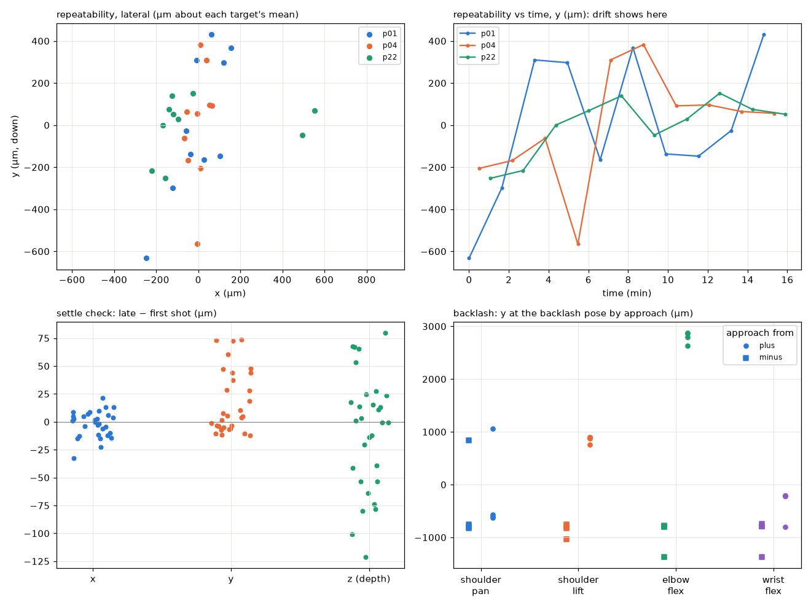

## 4. Kinematic calibration (step 10)

- **Data:** 221 shots / 92 poses from 4 runs (fit), plus an independent test of 17 never-fitted poses.
- **Model variants:** six, each in `config/kinematics/follower_<variant>.json`.

- **Full details:** `docs/results/step10_kinematic_calibration.md`.

| Variant | Adds | CV lateral | CV 3D | Test lateral | Test 3D | Test sub-mm lat |
|---|---|---|---|---|---|---|
| nominal | camera/tag transforms only | 1.57 | 1.98 | 2.02 | 2.18 | 4/17 |
| offsets | + lift/elbow zero offsets | 1.43 | 2.06 | 1.81 | 2.80 | 3/17 |
| links | + link geometry corrections | 0.89 | 1.66 | 1.01 | 1.34 | 10/17 |
| full | links + wrist offsets + tag scale | 0.89 | 1.67 | 1.02 | 1.35 | 10/17 |
| **stiff_lin** | links + linear gravity compliance | **0.74** | **1.07** | **0.79** | **1.14** | **13/17** |
| stiff_thr | links + shoulder compliance above 0.75 N·m | 0.91 | 1.79 | 0.92 | 1.28 | 12/17 |

*mm at the tag, relative to the iPad; CV = held out, 5-fold by pose.*

- **Link geometry and gravity compliance matter.** Zero offsets alone don't help.
- **The gravity term helps across the workspace,** not only at the far edge.

- **The residual is mostly depth along the camera's line of sight.**

- **Sub-mm poses (CV 3D):** nominal 6/92 → `stiff_lin` 59/92 (median 0.77 mm).

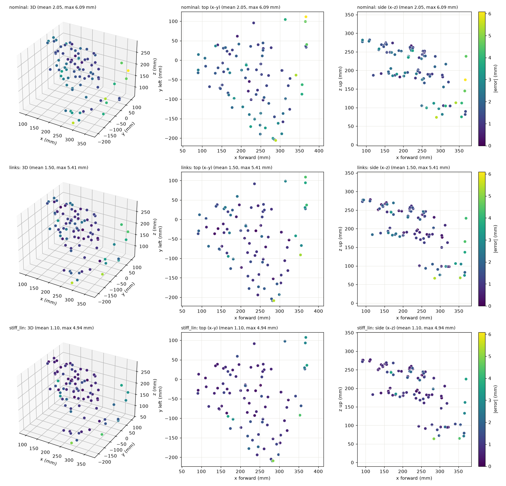

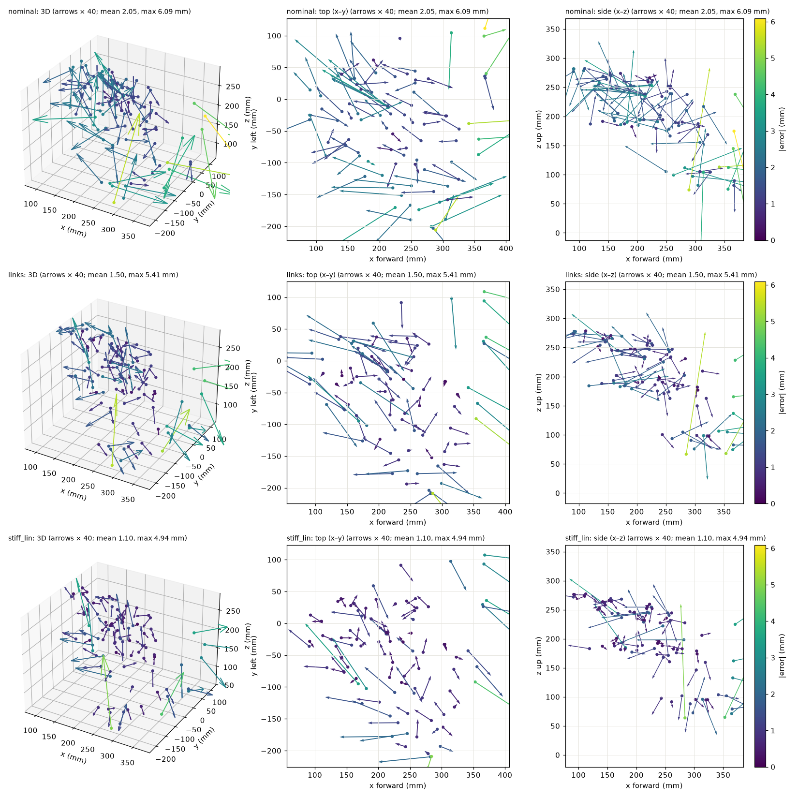

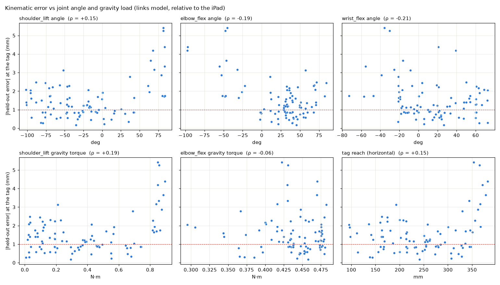

Interactive versions: `../figures/step10_error_dots.html`, `../figures/step10_error_map.html`.

## 5. Commanding with the calibrated model (step 10b, `20261031-135444`)

Re-anchored on the grid poses (`20261031-103300`) after the iPad moved; 13 targets × 3 methods.

| Method | 3D RMS | Lateral RMS | Max | Common offset (x / y / z) | Lateral scatter |
|---|---|---|---|---|---|
| nominal IK | 8.18 | 8.07 | 10.95 | +0.8 / **+7.5** / −0.8 | 2.91 |
| calibrated (`stiff_lin`) + bend/droop feedforward | 2.10 | 1.84 | 4.42 | −0.7 / −0.5 / −0.3 | 1.65 |
| **+ one encoder-reading correction** | **1.88** | **1.53** | **2.99** | −0.3 / +1.3 / −0.7 | **0.75** |

- **Calibrated commanding is better than nominal on all 13 targets.** The encoder correction, which uses only the servo's own reading, halves the landing scatter.
- **Re-anchoring lesson:** a first attempt anchored on poses where the model fits poorly carried ~2.6 mm of anchor offset. Anchor where the model is good.

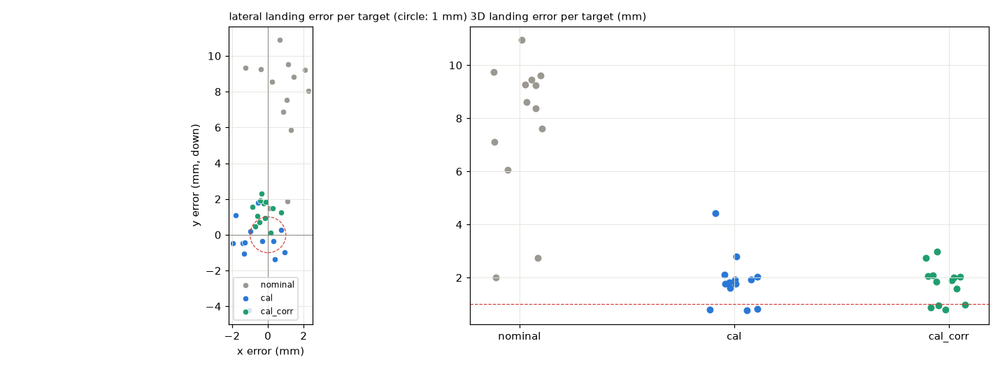

Animations: `../figures/kinematic_grid_rerun_20261031-103300.gif`, `../figures/validation_10b_20261031-135444.gif`.

## 6. Drift the encoders can and can't see (steps 5b(b), 11)

| Run | Observation |
|---|---|
| 5b(b), 30-min hold at `ready` (`20261030-125013`) | +258 µm sink with **no** encoder change; elbow 30 → 39 °C |
| **Step 11**, 45-min hold from cold (`20261031-152653`) | one −430 µm step at 3.2 min = **one elbow encoder tick** (2270 → 2269); otherwise ≤ 50 µm (~1.3 µm/min) while the elbow rose 29 → 41 °C |
| Step 11 cool-down, 30 min unpowered | lateral within 50–100 µm; no trend with temperature |
| Step 11 return to `ready` | back at the hold start (0 % of the drift left), same elbow tick |

- **What step 11 shows:** at a fixed pose, the drift is tick-sized, reversible and visible to the encoder. Continuous thermal drift is ~1 µm/min.
- **Open:** the 5b(b) sag with no tick change did not reproduce.

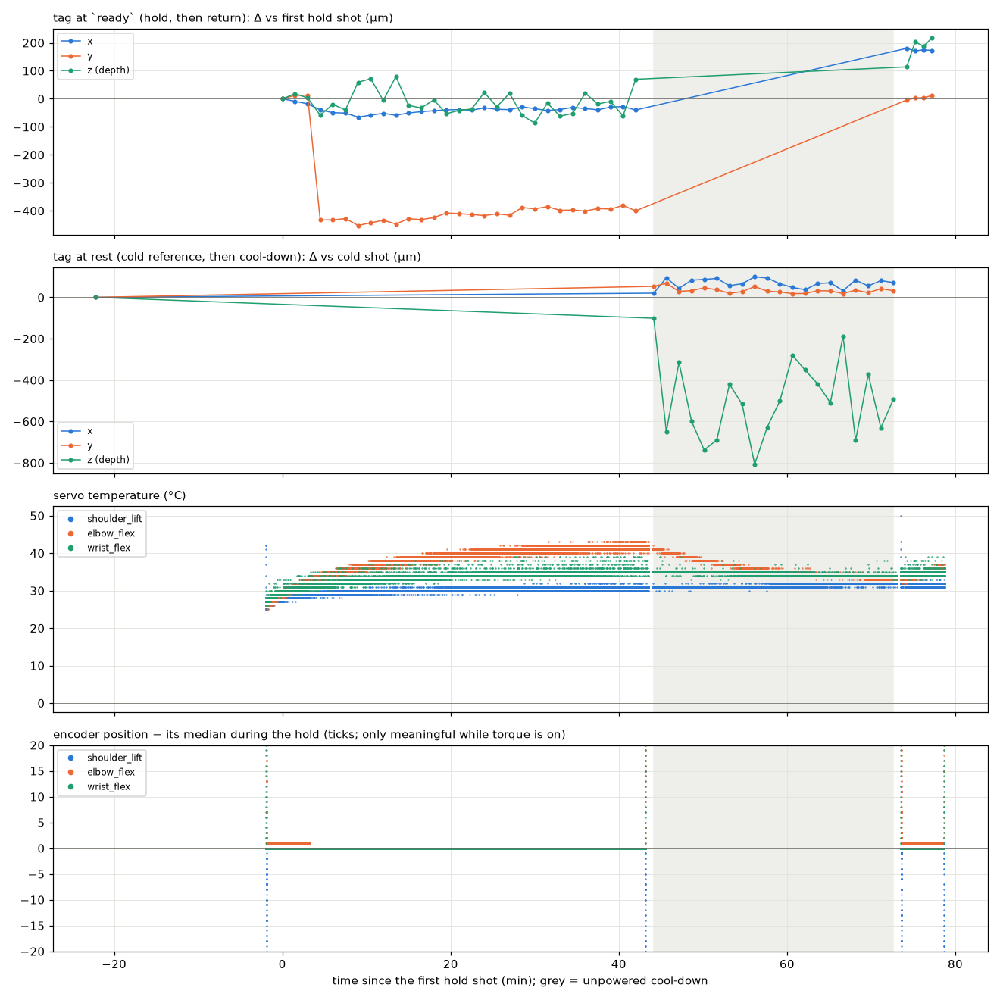

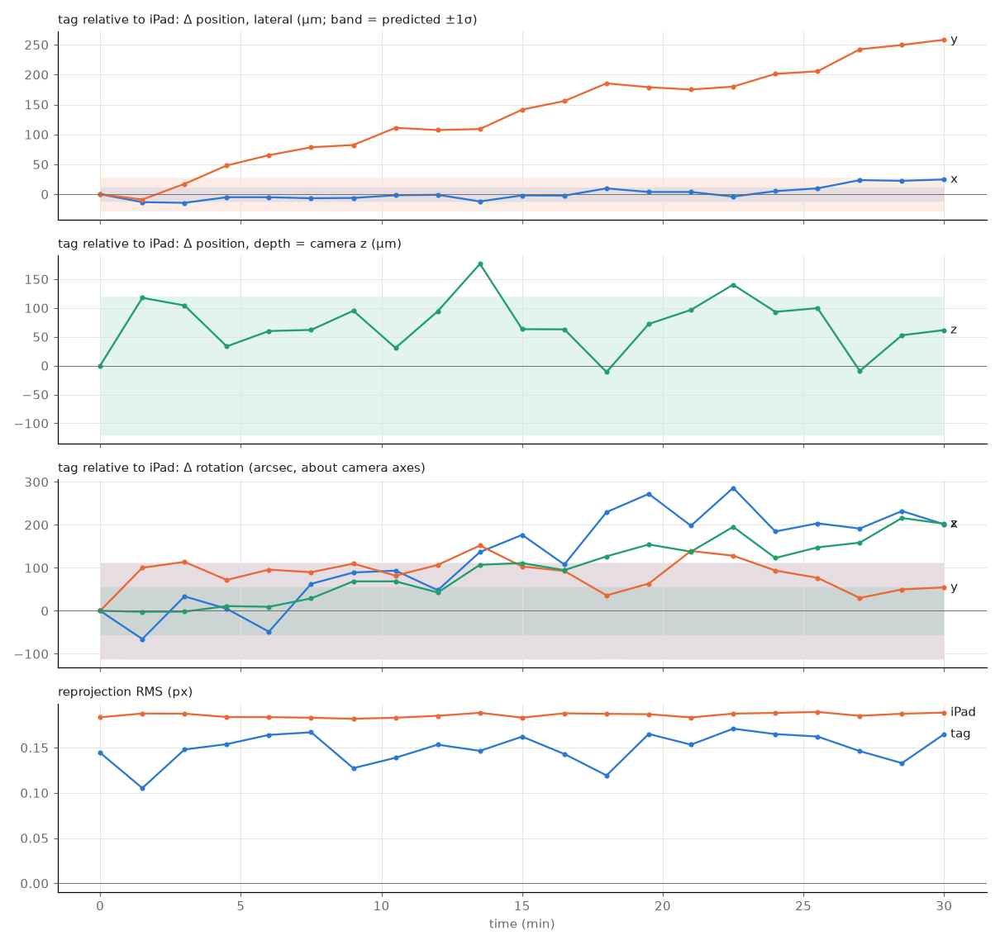

## 7. Limitations

- **Static only:** 1/30 s exposure, ~6 s per capture, unmeasured trigger lag. No dynamics (ring-down deferred, D11).
- **Tag, not tool tip:** the tool tip needs pivot calibration (D13).

- **Single 20 mm tag:** depth is the weak axis (~100 µm per shot) and dominates the residuals.

- **Workspace:** the top is cut off by the field of view; depth of field limits reach toward the camera.

- **Contact detection isn't gravity-aware:** a false trip at full reach (p39).

- **Nominal scale (D4):** results reprocess without recapture once measured.

- **Wrist compliance not separated:** the fitted wrist compliance (13°/N·m) can't be told apart from a wrist-pitch geometric error (step 9 deferred).

## 8. Implications for Phase 3

- **Static accuracy is model-limited and correctable without sensors:** 8 → ~2 mm with a calibrated model plus feedforward and one encoder correction.
- **Repeatability is limited by the servo deadband.** Approaching from one side, or correcting on the reading, attacks it.

- **The non-repeatable drift seen here is mostly encoder-visible** (1-tick re-settles). An external sensor is justified only if sub-mm absolute accuracy is needed, or if 5b(b)-type sag without tick changes recurs.

## Data and code

| Step | Runs | Analysis |
|---|---|---|
| 5b | `20261030-113927`, `20261030-125013` | `scripts/camera/target_pose.py` |
| 6 | `20261030-154331`, `20261030-162649` | `scripts/readonly/teach_poses.py`, `scripts/sim/plan_sector_tour.py`, `scripts/camera/handeye_fit.py` |
| 8 | `20261030-170704` | `scripts/camera/repeatability.py` |
| 10 | `20261030-190841` (+ step 6/8), test `20261030-202915` | `scripts/camera/kinematic_fit.py`, `kincal_error_map.py`, `kincal_gravity.py` |
| 10b | anchor `20261031-103300`, run `20261031-135444` | `scripts/camera/command_accuracy.py`, `reanchor.py` |
| 11 | `20261031-150441`, `…152451/152653`, `…161050/161101`, `…164018/164106` | `scripts/camera/thermal_drift.py` |

Plan, deviations D1–D15: `docs/phase-2-plan.md`. Lessons: `notes/LESSONS_LEARNED.md` (#4–#6).
