# Adventures with SO-101: How accurate is it, really?

## Summary

I recently bought a pre-assembled SO-101 to do what most people do with it and start training it to do tasks and play around with VLAs and what not. But first, I was a bit curious as to how well the arm actually worked - meaning, does it actually go where you tell it to? Most of the demos I've seen online of it are doing relatively-coarse precision tasks like picking up blocks and putting them in baskets and what not, but I wanted to know how accurate and precise it actually is. Figured it would be a fun project that blended some of the metrology and camera work I've done previously but now with a new end-case: a popular, hobby robotics arm! I wasn't able to find any similar type of characterization or measurement data, so to the best of my knowledge this type of characterization for SO-101 doesn't exist. Maybe because it's a **bit** overkill for something not designed to be super precise, but that's part of the fun I think :) 

I'll cut to the chase though if you're here just for the numbers. Out of the box, the SO-101 follower puts its gripper **about 8 mm from where it's told**, mostly sagging low under
gravity. After calibrating its kinematic model against camera measurements, it lands **within about 2 mm RMS
(3 mm worst case)**, and it **repeats to under 1 mm**. Two findings there:
- **Repeatability is set by the servos' deadband**, not by gear backlash.
- **Drift while holding a pose** is a tick-sized re-settle that the servo's own encoder reports, not slow thermal (at least self-induced) creep.  
 

  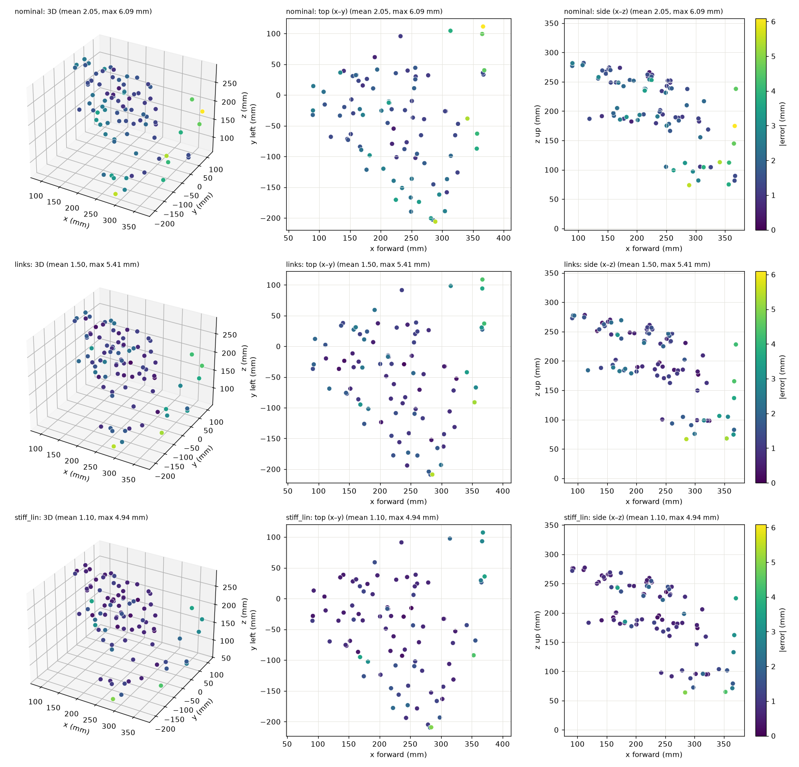
       
  <em>Per-pose error before and after calibration</em>

| Metric | Value |
|---|---|
| Accuracy, stock kinematic model | 8.2 mm RMS (lands ~7.5 mm low) |
| Accuracy, calibrated model + one encoder correction | **1.9 mm RMS**, 1.5 mm lateral, 3.0 mm max |
| Knowing where the gripper is (calibrated model, from the encoders) | 0.8 mm lateral, 1.1 mm 3D RMS |
| Repeatability (same target, same approach) | **0.7–0.9 mm** |
| Drift holding a pose for 45 min | one 1-tick step (~0.4 mm); otherwise ~1 µm/min |

👆 *All at the gripper tag (not the fingertip), in the arm's inner workspace, with the arm warmed up and settled.*

If you're curious as to how I've arrived at these numbers, read on through!

## The setup

  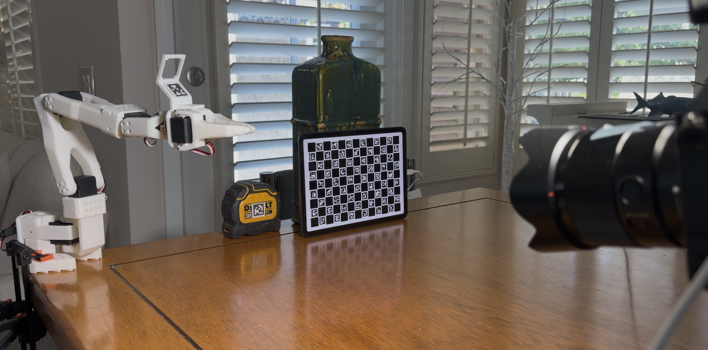
       
  <em>The rig: arm on the left, iPad reference in the middle, camera on the right</em>

**The arm.** The follower clamps to a table corner (I had to use 4 clamps because the base wasn't completely flat against the table with just two)

**The camera.** It sits ~0.6–0.7 m away on a table-top tripod: Sony A7IV, 35 mm lens at f/11, manual focus taped, RAW files
pulled over USB with `gphoto2`. At ~0.65 m, with a calibrated focal length of ~7007 px, each pixel covers ~0.1 mm (650 mm / 7007 px), and the full 7028 × 4688 px frame spans roughly 65 × 44 cm.

**The reference.** An iPad standing beside the arm shows a custom-designed ChArUco board, rendered exactly at the screen's native resolution. It's flat, rigid glass, and the pattern is defined in software. Every arm measurement is the tag's
position **relative to the iPad in the same photo**, so if the camera, tripod or table moves, it cancels out.

**The target.** A 20 mm AprilTag, printed and stuck to the plate under the gripper's camera mount. 

  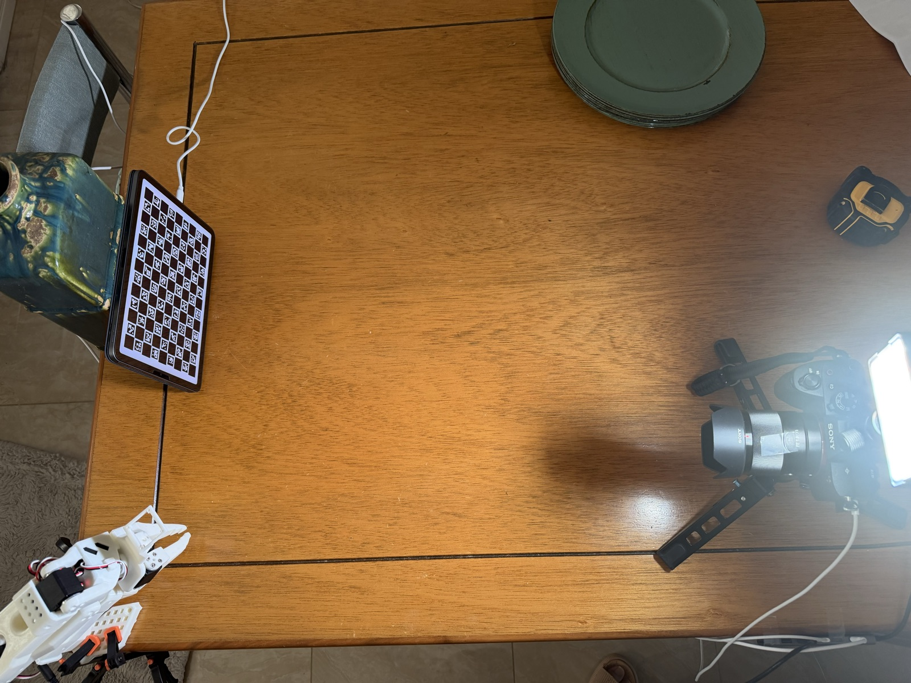
       
  <em>Top-down view of the layout (early version)</em>

**Equipment:**

| Item | Details | Used for |
|---|---|---|
| **Robot arm (follower)** | SO-101, 6 × Feetech STS3215 (12-bit encoders, firmware 3.10), 12 V supply | The arm being measured |
| **Robot arm (leader)** | SO-101 leader, 6 × STS3215, 5 V supply | not used for this activity |
| **Servo bus boards** | 2 × CH343 USB-serial boards, 1 Mbps half-duplex bus | Mac ↔ servos |
| **Base clamps** | 4 stock bar clamps; arm moved to a table corner after the base was found rocking | Holding the arm's base |
| **Computer** | MacBook Pro M1 Pro, 16 GB, macOS | Control, logging, capture, analysis |
| **Camera** | Sony A7 IV, 33 MP (firmware 3.01), tethered over USB (gphoto2), ISO 1600, IBIS off | Measuring instrument |
| **Lens** | Sony FE 35 mm f/1.8 (SEL35F18F), run at f/11, manual focus w/ ring taped| Fixed focal length, deep depth of field |
| **Lighting** | Aputure MC Pro Panel, 100% intensity, CCT at 5400K | Keeping shutter speed and ISO at reasonable values for image processing |
| **Tripod** | Table-top tripod, ~0.65 m from the scene | Camera mount (shares the table, so nobody touches it during runs) |
| **Reference target** | iPad Air M1 (2360 × 1640, 264 ppi) showing a pixel-exact ChArUco board | Camera calibration and the fixed reference for every measurement |
| **Gripper target** | AprilTag 36h11 ID 2, 20 mm, printed on paper, backed with a gift card, taped to the wrist-camera mount plate | Marks the gripper's position in each photo |
| **Caliper** | One visual reading of the printed scale bar (±0.05 mm) | Print-scale check; full scale anchoring deferred |
| **Tape** | On the lens focus ring and the tag mount (double-sided) | Holding focus and the tag fixed |

## Getting the arm ready

Before measuring anything, the arm had to move safely and predictably (I didn't want to damage the table 😅). A few things stood out:
- **The servos power up with a target of position 0 at unlimited speed.** Turning torque on naively would slam each joint toward one end of its travel. The control layer first sets every target to the current position and caps speed and acceleration, then enables torque: **0 ticks of motion at torque-on.**
- **There are no firmware position limits,** so all limits live in software. EEPROM writes are blocked entirely.
- **Stopping is two-stage:** the first Ctrl-C freezes in place (holding), the second turns torque off. Torque-off alone drops the arm under gravity.
- **Collisions:** the arm hit itself once and the table once during early sweeps. This led to some safeguards being implemented: a contact detector (freeze when a joint lags its target unusually), and a MuJoCo geometry check that prevents any planned path coming within 3 mm of the table.
- **First calibration:** joint zeros were set by eye against the 3D model, then one refinement from touching the table: ~1.5 mm at table level.

| Check | Result |
|---|---|
| Servos | 12/12 healthy, firmware 3.10, no error flags |
| Communication | 100 Hz control loop; 0 failed reads in 96k samples over 15 min |
| Encoder repeatability | ±3 ticks over 30 returns in 15 min |
| All-joint tour | 17 waypoints, every joint moving together, no faults |

One funny thing that I couldn't find many community references on: the servo temperatures were quite noisey. I would often see spikes of 5-10 ˚C while streaming the telemetry (at rest) and even reads reaching over 100 ˚C when moving, so anytime I did want to use the temperatures, I used a .5 second debounce. Otherwise, I had a median filter on for plotting in the TUI.

  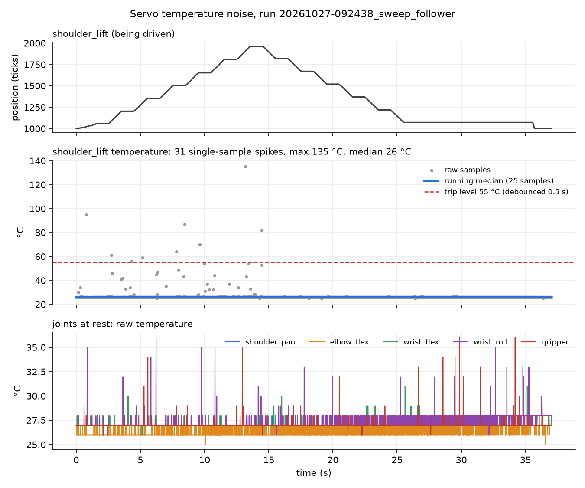
       
  <em>Servo temperature readings: single-sample spikes on the moving joint, smaller glitches on the wrist servos at rest</em>

## Improv Camera Metrology: How the measurement works

Like I said, part of the fun was to come up with a reasonably accurate metrology set-up (read: sub-mm) with what I had on hand and not trying to spend much to acquire additional tools. I am cheating a bit here though because I have a Sony A7IV handy for my photography/videography hobby, so that definitely saved me a good chunk of cash. Otherwise, I only spent on getting a set of calipers and double-sided tape for mounting the AprilTag on the arm.

  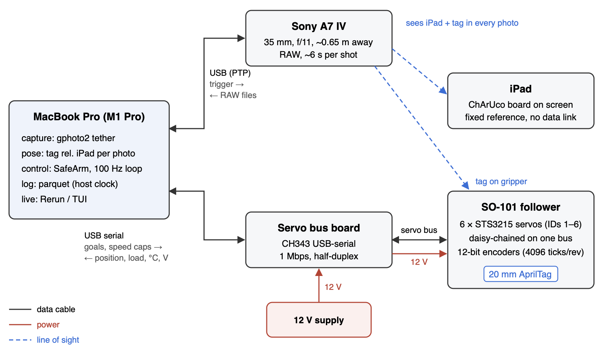
       
  <em>Measurement setup: the Mac tethers the camera and drives the servo bus; the camera sees the iPad and the tag in every photo</em>

A note first on what limits the measurement’s accuracy. For anything measured as a difference between photos (repeatability, drift, backlash), the limit is per-shot noise: 5–15 µm across the image and ~100 µm in depth, set by how precisely the corners of a small 20 mm tag can be found. For absolute position, the limit is scale. The camera reads the tag’s distance from its apparent size, so a size error carries straight into distance (δZ/Z = δL/L): a 0.1 % error in the tag’s printed size (20 µm) moves the measured position ~0.65 mm along the line of sight at 0.65 m. A caliper check of the print (100.05 mm on a 100 mm bar, as well as I could align it by eye) puts the print scale within about 0.05 %, but I didn’t measure the iPad’s pixel pitch directly. This bias is nearly constant across the workspace, so it cancels in differences and is absorbed by the calibration fit. It is the reason I don’t quote absolute positions. With per-shot noise well under 0.1 mm, the setup comfortably met my requirement of resolving sub-mm motion, so I moved on.

  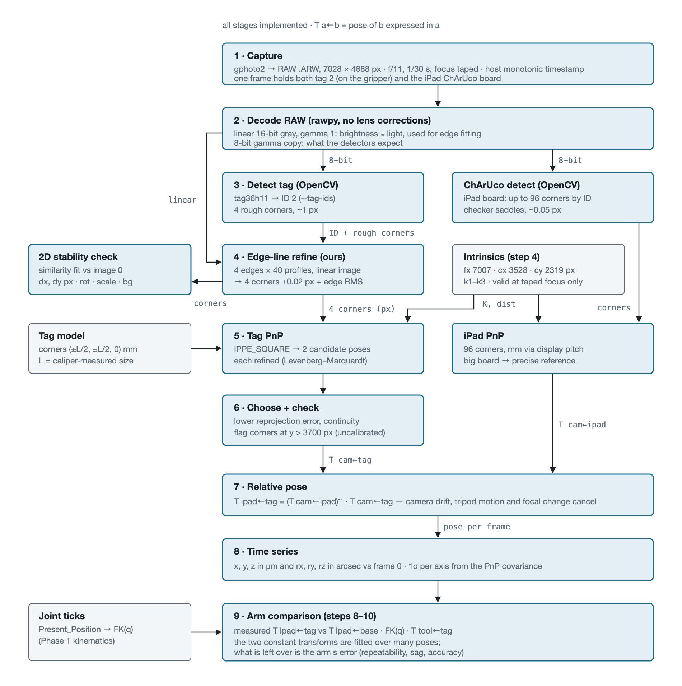
       
  <em>Capture-Processing Pipeline: From RAW photo to tag pose relative to the iPad</em>

### Pipeline
Each photo yields two poses: the iPad's (from up to 96 board corners) and the tag's (from its 4 corners). The tag's pose relative to the iPad is the measurement, with iPad serving as the reference coordinate system. Before doing any AprilTag measurements, I first needed to calibrate the intrinsics of the camera in order to convert the pixel level measurements to a precise viewing direction. Converting those directions into µm then comes from the known sizes of the targets: the 20 mm tag and the iPad board’s pixel pitch. The calibration was done by taking 41 photos of the iPad's ChArUco board at different positions and tilts, with focus set to one position (manual and taped). The fit came out to .17 pixel reprojection RMS (focal length ~ 7007 pixels) and it is only valid at that focus position and outside the bottom 20% frame, which I wasn't able to take captures of due to the iPad colliding with the table.

The small tag's 4 corners have to be very precise. OpenCV's built-in corner refinement pulls the outer corners of a tag ~0.17 px inward. Fitting gamma-corrected images shrinks the tag by a blur-dependent 0.2–0.6 px per edge. So I fit a straight line to each tag edge on the **linear** RAW data and intersect the lines. On synthetic tags that's unbiased to ~0.03 px.

On real photos the edge points sit within 0.1–0.25 px RMS of their fitted lines. The larger bumps, up to ~0.6 px (~60 µm on the tag), repeat between photos of the same pose, and one edge is rough (0.19–0.28 px) in every pose, so they most likely come from the printed tag itself (print or paper edge), not the fit. It's standard printer paper with card backing, so there was a bit of deformation when adhering to the backing tape.

  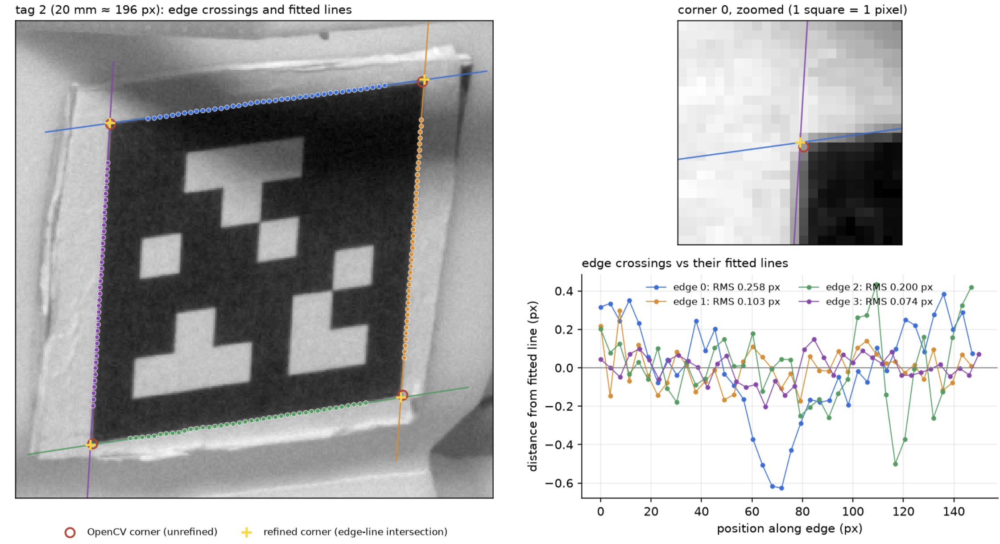
       
  <em>Debug overlay for AprilTag Detection</em>

**How good is it?** With the arm resting and nothing moving (30 minute test):

  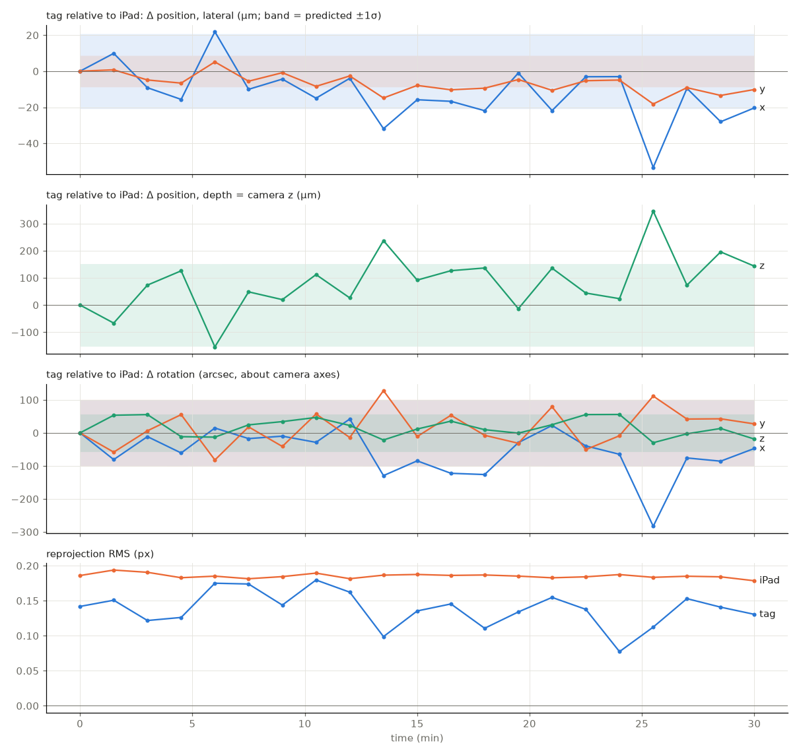
       
  <em>Stability Test: Tag relative to the iPad over 30 min at rest</em>

These results helped convince me to move forward with the workspace measurements as the lateral drift is pretty minimal, which eased my concerns about creep from the adhesive, thermals, table moving (though I did have a few measurements I had to throw out because I bumped into it during the test), iPad stability, so on.

Summarizing per axis into a table:

| Direction (camera frame) | Noise per photo | Drift over 30 min |
|---|---|---|
| Across the image (x, y) | 5–15 µm | ≲ 25 µm |
| Depth (along the camera's line of sight) | ~100 µm | not resolved (≲ 0.2 mm) |

Depth is the weak axis. Moving the tag sideways shifts every corner one-for-one, but moving it along the line of sight
only changes its apparent size, and only slightly. In numbers, with distance Z ≈ 650 mm, focal length f ≈ 7007 px and
tag size L = 20 mm (≈ 196 px across in the image):

- **Sideways:** x = Z·u / f, so a corner error δu moves the estimate by δx = (Z/f)·δu ≈ 0.093 mm per pixel. A
  ~0.1 px corner error gives ~9 µm.
- **Depth:** the camera infers distance from apparent size, Z = f·L / s, so δZ = Z·δs / s ≈ 3.3 mm per pixel of size
  error. A ~0.03 px size error (four corners averaged) gives ~100 µm.

Per pixel, depth is Z/L ≈ 32× more sensitive than sideways. Averaging the corners claws some of that back, leaving the
~10× gap in the table.

One practical finding I had iterating on the measurement: soft focus about doubles the corner noise (measured, not assumed) but stays usable for relative measurements.

## Repeatability: deadband-limited

To test repeatability, I sent the arm to three targets spread across the workspace (close-in low, close-in high, and stretched far forward), ten times each, always approaching from the same side.

  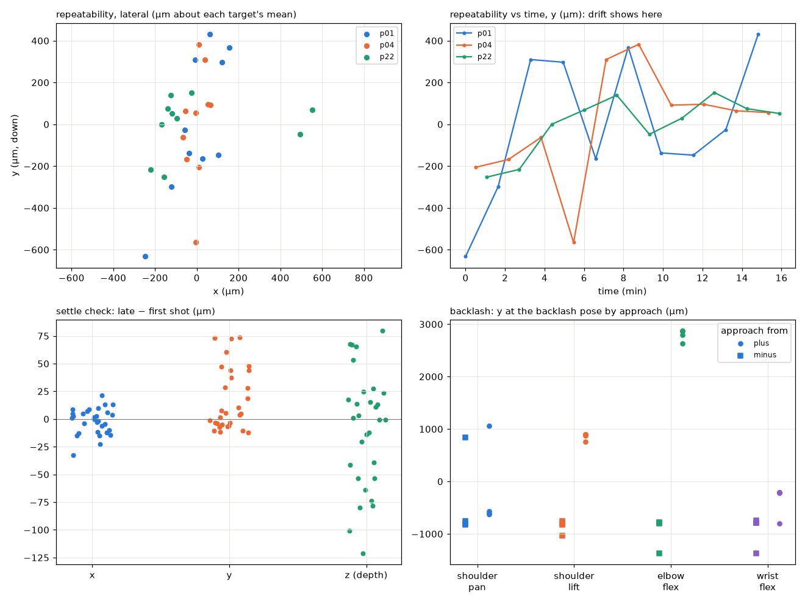
       
  <em>Repeatability at three targets</em>

| Target | Spread x / y / z (µm, sd) | ISO 9283 repeatability |
|---|---|---|
| Close, low (p01) | 123 / 344 / 106 | 0.84 mm |
| Close, high (p04) | 45 / 271 / 140 | 0.78 mm |
| Far forward (p22) | 281 / 137 / 187 | 0.86 mm |

**The spread comes from where the servos stop.** Each return lands 0–2 encoder ticks differently, and those tick
differences predict the spread (r = 0.72–0.87). One tick is small but not negligible: the encoders count 4096 ticks
per turn, so 1 tick = 0.088° ≈ 1.5 mrad, and the gripper moves that angle times its distance from the joint. That's
0.2 mm at 130 mm from the joint and 0.4 mm at 260 mm.

**Approach direction matters more.** Coming from opposite sides, each joint stops 5–12 ticks apart. The camera and
the encoder agree on that offset to within about a tick:

| Joint | Camera says | Encoder says |
|---|---|---|
| shoulder pan | 7.0 ticks | 8.0 |
| shoulder lift | 7.0 | 7.5 |
| elbow | 11.9 | 12.5 |
| wrist flex | 5.2 | 5.0 |

The difference matters for the fix:
- **Backlash** is slack in the gears, which lets the output shift under changing load without the motor commanding it.
- **Deadband** is the controller stopping once it's "close enough", within a few ticks of the target, short on
  whichever side it approached from. The encoder sees it.

Camera and encoder agree, so this is deadband, not hidden gear backlash. Which is good, as it indicates the servo already knows how far off it is.

## Accuracy: calibrating the model

**The question:** How well does the arm's model predict where the gripper actually is? I fitted correction terms to
221 photos (92 distinct poses, the calibration) and tested on 17 independent poses that were separate from the fitting data (the validation).

**What was fitted.** Joint zero offsets, small corrections to each link's length and angle, and a gravity term: each
loaded joint bends by an amount proportional to the torque gravity puts on it.

  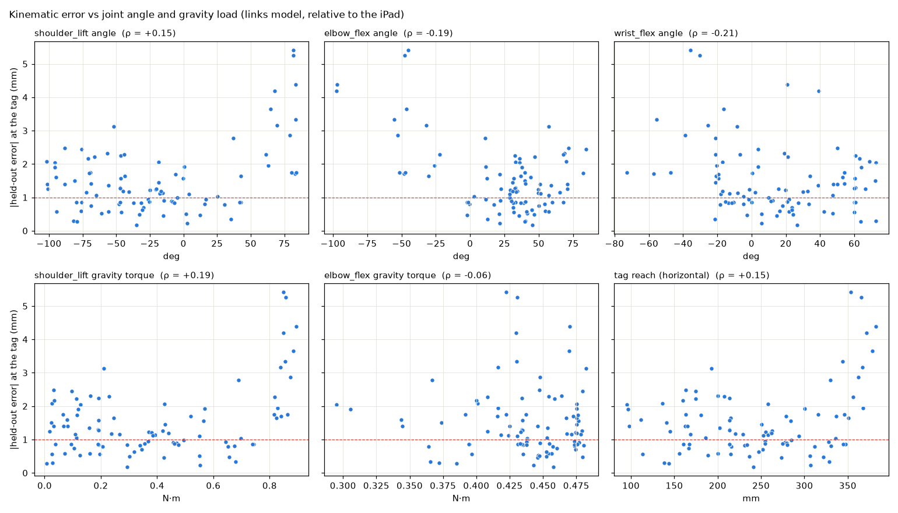
   
  <em>Error left after correcting link geometry, before adding gravity</em>

Looking at the figure above, you can see some clustering occuring for angles corresponding to higher gravity load, though there's not a direct linear correlation. However, it isn't random: it jumps once the shoulder carries ~0.8 N·m, the far-forward reach. That's what the gravity term targets and just partly fixes.

| Model | Validation RMS (17 poses): lateral | 3D | Calibration poses under 1 mm 3D (cross-validated) |
|---|---|---|---|
| Stock (CAD geometry) | 2.0 mm | 2.2 mm | 6 / 92 |
| + joint zero offsets only | 1.8 mm | 2.8 mm | — |
| + link geometry corrections | 1.0 mm | 1.3 mm | 36 / 92 |
| **+ gravity bending** | **0.8 mm** | **1.1 mm** | **59 / 92** |

The error columns are the 17 validation poses. The last column counts calibration poses predicted to under 1 mm by a
fit that left that pose out (cross-validation).

Why is the stock model only 2 mm off here, but 8 mm off when commanding (next section)? Here every model, stock
included, also fits where the camera sits relative to the base and where the tag sits on the gripper. Those two fitted
transforms absorb most of the constant ~7.5 mm sag, so this table measures how well each model gets the *shape* of
the workspace right. Commanding has no such freedom, so the sag shows up in full.

Findings:
- **Link geometry and gravity matter.** Fitting only the joint zeros, the classic "calibration", doesn't help on unseen poses (barely helps lateral error and hurts in 3D).
- **The gravity term improves the whole workspace,** not just the far reach.
- **What's left points along the camera's line of sight,** i.e. depth, the measurement's weak axis.

  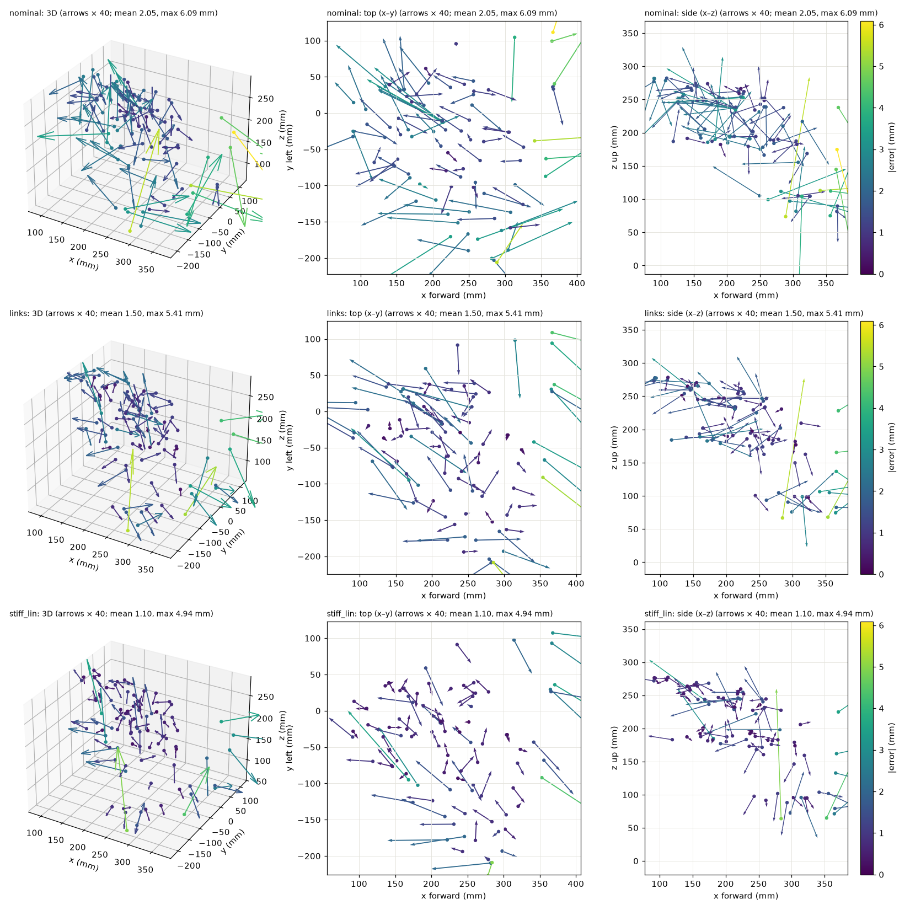
       
  <em>Error vectors (×40) point along the camera's line of sight</em>

The far-forward reach, where the shoulder holds the most weight, stays at 2.5–5 mm.

## Commanding the arm

Knowing where the arm is differs from putting it there. I picked 13 target points and commanded each three ways:
1. **Stock model (nominal),** angles as computed.
2. **Calibrated model (cal),** plus a prediction of how far each servo will sag short of its target under load + the pre-compensation for the arm's gravity bending.
3. **As 2, plus one correction (cal_corr):** read the encoders after settling and nudge once.

  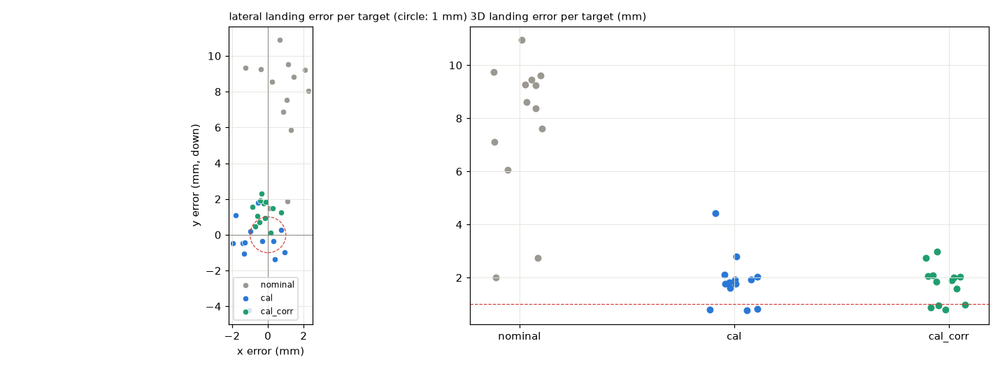
       
  <em>Where the tag landed vs where it was told to go</em>

| Method | 3D RMS | Lateral RMS | Worst | Spread between targets (lateral) |
|---|---|---|---|---|
| Stock | 8.2 mm | 8.1 mm | 11.0 mm | 2.9 mm |
| Calibrated + sag prediction | 2.1 mm | 1.8 mm | 4.4 mm | 1.7 mm |
| **+ one encoder correction** | **1.9 mm** | **1.5 mm** | **3.0 mm** | **0.75 mm** |

- **The stock model puts the gripper ~7.5 mm too low,** because it accounts for neither the servos' sag under load nor the arm's bending.
- **The calibrated model is better on all 13 targets.**
- **The encoder correction halves the target-to-target spread,** using nothing but the servo's own position reading.

  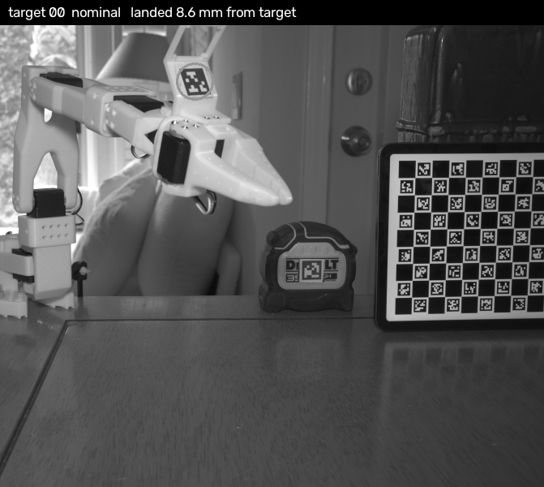
     
  <em>Commanding: the 13 targets, each run three ways</em>

## What the encoders miss

**The question:** Would an external sensor make the arm more accurate? That depends on how much the gripper moves
without the encoders noticing.

  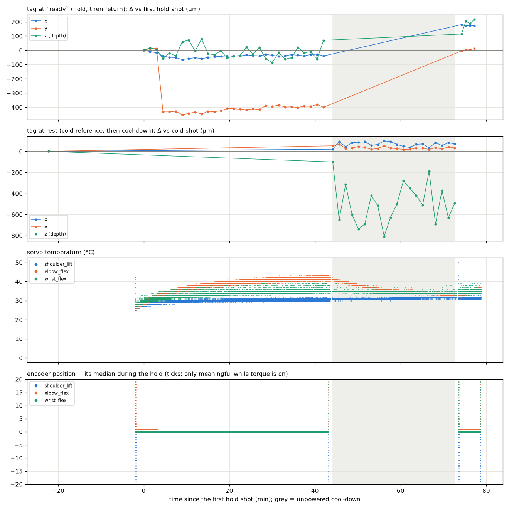
       
  <em>45-min hold, cool-down and return</em>

**Holding a pose for 45 min from cold** (elbow servo 29 → 41 °C):
- **One step:** the tag jumped 0.43 mm at minute 3, the same moment the elbow encoder changed by exactly one tick.
- **Otherwise flat:** under 50 µm over the remaining 40 minutes, despite the 12 °C rise.
- **Cooling:** 30 min unpowered moved the rest pose less than 0.1 mm.
- **Return:** going back to the pose put the gripper exactly where it started.

So the drift during a hold is a single servo re-settling by one tick, and the encoder reports it. Slow thermal drift is
around 1 µm per minute.

**One exception, not reproduced:** in an earlier 30-minute hold, the tag sagged 0.26 mm with no encoder change at
all. The 45-minute hold above didn't show it again, so its cause is still open.

One note: there is noticeable wobble with type quasi-static movements conducted for these measurements. The arm wobbles visibly after a stop, and the encoders aren't able to see it. Neither can this camera: 1/30 s exposures, one photo every ~6 s. Measuring it would need a fast sensor + read-out interface.

## Lessons

- **Measure against something that only moves with what you care about.** The iPad made camera motion irrelevant. Leaning on the table moved the camera 0.13 mm.
- **Check sign conventions against a known input.** A drift-tracking script had its sign flipped for two days. It was invisible until two independent measurements disagreed.
- **Always state the reference frame.** I briefly computed accuracy in the wrong frame. It didn't change the numbers, but it could have.
- **Simulate before moving, and test the failure paths.** I was able to catch a path 2.9 mm from the table in the simulator.
- **Measure, don't assume.** Soft focus "should" be unusable; it doubles the noise and works fine for relative measurements.

## Limitations

- **Static only:** no dynamics. The camera is too slow.
- **Measured at the tag, not the fingertip.** The fingertip adds the orientation error × ~10 cm.
- **One 20 mm tag:** depth is the weak axis and dominates the residual error.
- **The workspace is limited by the camera's depth of field and field of view;** high poses are cut off.
- **The far-forward reach is under-sampled:** the contact detector isn't gravity-aware and falsely tripped there once.
- **Absolute scale is nominal** (≤ 0.3 %, set by the iPad's pixel pitch); results can be reprocessed later with a measured scale.

## What'd be next

- **For ~2 mm accuracy, model compensation is enough:** a calibrated model, a sag prediction and one encoder check. No extra hardware.
- **Approach-direction offsets are a servo-control problem:** always approach from the same side, or correct on the encoder reading.
- **An external sensor** can help w/ accuracy, not repeatability. It can see the model error the encoders miss, which is bending, worst at the far reach (2.5–5 mm), and correct it down to the servos’ repeatability floor (~0.8 mm). Below that, the limit is the servos’ deadband, and only better servos fix it.

**A note on tooling.** I built most of the software with Claude Code (servo interfacing, camera tethering, the image-processing pipeline, the calibration fits). This greatly helped speed up the project (weeks to days) while still letting me learn and challenge assumptions about the hardware work (I ran every hardware step myself) as well as software assumptions when I saw inconsistent or erroneous data.

---

## Appendix

### A. Workspace planning

The usable workspace was set by the camera, not the arm. I posed the unpowered arm by hand at the extremes I wanted,
photographing each pose. From those I built a spherical sector (reach, azimuth, elevation) and filled it with an
even grid. Each grid point was then:
- solved for joint angles;
- checked against the table, the joint limits and an iPad-side pan limit;
- given the wrist angle that turns the tag most squarely toward the camera, predicted by a hand-eye fit (camera ← arm base, tag ← gripper).

That raised tag visibility from 18/23 to 28/29 poses.

  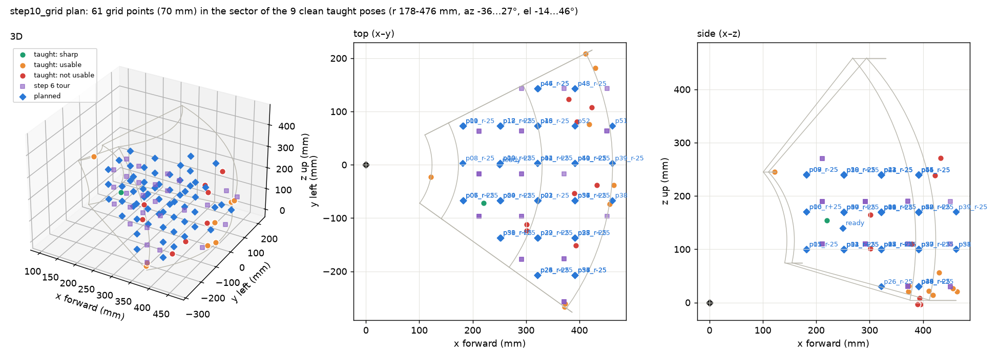
       
  <em>Planned grid (blue) over the hand-taught poses</em>

### B. The math

**Definitions.** *Lateral* is error across the image (camera x, y); *depth* is along the line of sight. *3D RMS* =
√(mean ‖error‖²). *ISO 9283 repeatability* = mean distance of the landings from their centre + 3 standard deviations.

**Measurement model.** tag pose (in the camera) = Rᵢ · X · F(q; θ) · Y. F is the arm's kinematics with fitted
corrections θ; Rᵢ is the iPad's pose, measured in each photo; X (iPad → base) and Y (gripper → tag) are fitted. X and
Y absorb any constant offset, which is why stock scores 2 mm in the Accuracy table but lands 8 mm off when commanded.

**Gravity term.** true angle = encoder angle + c · τ(q), with τ the gravity torque on each pitch joint. The shoulder
fits to ~2°/N·m, i.e. ~1.8° of bend at the far reach, which the encoder can't see.

**Commanding.** cal solves for the joint angles, then aims past them by the predicted bend and servo sag. cal_corr
then reads the encoders once and nudges each joint by its miss (≤ 30 ticks).

**Cross-validation.** The 92 calibration poses are split into 5 groups (repeat photos of a pose kept together); each
group is predicted by a fit on the other four.
